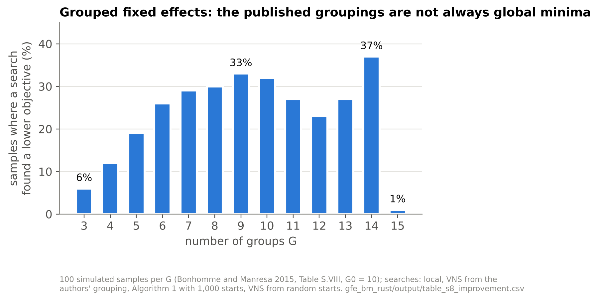

# What the Rust version changed

Eliot R. Weinstein · eliotw@uchicago.edu · erweinstein.com · 18 November 2026

This note records what writing grouped fixed-effects (GFE) estimation in Rust bought, measured against the
Python translation ([gfe_bm_python](https://github.com/erweinstein/gfe_bm_python)) and against a C++ port of
the same code through Rcpp. The estimator and its algorithms are Bonhomme and Manresa's (2015); see the
README for credit.

## The result it made possible

The Monte Carlo of the paper's Table S.VIII chooses the number of groups by the BIC of the supplement's (S20):

BIC(G) = Q(G)/NT + σ̂² (GT + N + K) ln(NT)/NT,  with σ̂² = Q(G_max)/(NT − G_max T − N − K) from the G = 15 fit.

So a search that stops short at G = 15 raises σ̂², inflates the penalty and pushes the chosen G down. The
objective Q(θ, α, g) = Σᵢ Σₜ (yᵢₜ − xᵢₜ′θ − α_{gᵢ t})² is minimized over all G-partitions of the N = 90 units;
Algorithm 1 is a k-means-type descent, so it needs many random starts, and the variable neighbourhood search adds
jumps and single-unit moves. The Rust code ran 1,300 independent (sample, G) jobs, each with 1,000 Algorithm 1
starts and two neighbourhood searches, in parallel (about 3.3 minutes per sample on 2 cores). That depth showed:

- some search beat the authors' grouping in 6% of samples at G = 3, 26–37% at G = 6–14 and 1% at G = 15 (mean
  gain 0.004–0.044; largest 0.46);
- because the G = 15 fits barely move, σ̂² and the published BIC choices survive (G = 9 in 46 rather than 42
  samples, G = 10 in 40 rather than 42);
- Algorithm 1 alone never reaches the best objective from G = 13 on, so it overstates σ̂² by 3.5% and shifts the
  choice down (G = 10 in 32 samples).

The README's results section has the full table.

## Measured speed

One thread, on an idle 2-core Linux container, all three implementations in one session; medians over 5 samples
× 3 runs of the compute time each program reports (reading the input files dominates the whole-process time).
G = 10.

| Task (unit of work) | Python (NumPy) | Rcpp | Rust |
|---|---|---|---|
| Algorithm 1 (one random start; 1,000 starts per run) | 1.81 ms | 0.165 ms | 0.209 ms |
| Local search from the authors' grouping (one search; 20 per run) | 10.1 ms | 5.98 ms | 11.3 ms |

Versions: Python 3.13 with NumPy 2.5; Rcpp 1.1.22 with g++ 13.3 at R's default -O2; Rust 1.97 with opt-level 3
and link-time optimization.

- Rust is 8.7× faster than Python on Algorithm 1, but not on the local search. Python's local search updates
  sufficient statistics for each trial move, while Rust's recomputes the objective, and the better algorithm wins
  (Rust takes 1.12 times as long). All three reach the same objectives to 10 digits on the 5 samples.
- The Rcpp version is a line-for-line port of `src/lib.rs`, written for this comparison and not yet in a
  repository. It is faster than Rust on both tasks (1.3× and 1.9×) and gives the same local-search objectives as
  Rust on all 20 (sample, G) cases checked; from 1,000 starts its Algorithm 1 finds the same best objective on 10
  of 20, a lower one on 4 and a higher one on 6, because its random starts come from R's generator. I have not
  diagnosed why the Rust version is slower; bounds checks on the index arithmetic in the inner loops are one
  candidate. R's -O3 was slower than its default -O2 here (0.204 and 8.36 ms).

So the speed is that of compiled code, not of Rust in particular. What Rust added was the parallel driver:
rayon runs work only on types the compiler can prove safe to share (Send and Sync), so the 1,300 jobs run in
parallel without data races (Jung et al. 2018), and each (sample, G) job owns a Xoshiro256++ stream (Blackman
and Vigna 2021) seeded from its indices, so results do not depend on the number of threads. The rows of
`output/table_s8_search.csv` are written as jobs finish, so only their order varies between runs.

## Possible problems

- **The two Algorithm 1 versions are not identical.** When a group would be empty, Rust moves the unit farthest
  from its group path into it, while the Python translation abandons the start. From 1,000 starts at G = 10 the two
  reach the same objective on 2 of 5 samples and Rust a lower one on the other 3 (for example 8.5261 against
  8.5334). That could be the repair or the different random streams; I have not separated them.
- **A local search with Python's update rule would be the fair test** of the language on that task; not done.
- **The benchmarks are small**: one machine, 2 cores, short runs.
- **A metadata inconsistency.** `Cargo.toml` declares `license = "MIT"`, while `LICENSE` and `NOTICE.md` say BSD
  3-Clause. One of them should be fixed before anyone depends on the crate.

## References

- Blackman, D. and S. Vigna (2021). Scrambled linear pseudorandom number generators. *ACM Transactions on
  Mathematical Software* 47(4), 1–32. doi:10.1145/3460772
- Bonhomme, S. and E. Manresa (2015). Grouped patterns of heterogeneity in panel data. *Econometrica* 83(3),
  1147–1184. doi:10.3982/ECTA11319
- Jung, R., J.-H. Jourdan, R. Krebbers and D. Dreyer (2018). RustBelt: securing the foundations of the Rust
  programming language. *Proceedings of the ACM on Programming Languages* 2(POPL), article 66.
  doi:10.1145/3158154
